# Aplicativo CERISE AR — geração de objetos 3D a partir de fotos (lado do aplicativo), adequação à Google Play e finalização Android/iOS

**Atividades do Plano de Trabalho 2026:** Objetivo 1 · Atividade 2 (versão funcional do aplicativo com suporte à geração de objetos 3D texturizados — componente móvel) e Objetivo 2 · Atividade 6 (aplicativo publicado na Play Store — adequação aos requisitos técnicos e normativos).
**Coordenação da área:** Prof. Dr. Carlos Galvão Pinheiro Junior (Realidade Aumentada). **Bolsista:** Eduardo Martins de Carvalho Caixeta.
**Repositório:** `cerise-ar` — branch `feat/2026-gen3d-playstore` (código em `cerise-expo/`); desenvolvido originalmente em https://github.com/EduardoCaixeta/cerise-ar (privado), com *pull request* em rascunho https://github.com/EduardoCaixeta/cerise-ar/pull/1. Neste repositório, os caminhos `evidencias/` e `resultados/` citados abaixo ficam em `docs/relatorio-2026/`, e `store/` corresponde a `cerise-expo/store/`.
**Data das medições:** 26/10/2026 (etapa base, contra o *mock*, de madrugada; integração final contra o servidor 3D real, entre 13:06 e 13:33 UTC — Seção 4.6).

---

## 1. Objetivo

O CERISE AR é o aplicativo de realidade aumentada (RA) do CERISE, reescrito em 2026 em React Native/Expo para permitir atualização de código por OTA nas duas plataformas. Esta etapa teve quatro metas:

1. **Geração 3D (lado do app):** permitir que o usuário fotografe um objeto, envie a imagem ao servidor de geração 3D do CERISE (construído em paralelo por outra frente, no DGX Spark), acompanhe a fila e o processamento, baixe o modelo GLB texturizado e o visualize em 3D e em RA.
2. **Play Store:** deixar o aplicativo tecnicamente e normativamente apto à publicação (nível de API, páginas de 16 KB, permissões, assinatura, política de privacidade, formulários de segurança de dados e classificação etária, ficha da loja).
3. **Finalização Android/iOS:** versão 1.1.0 compilada e testada no emulador Android e no Simulador iOS, com guias para instalação em aparelho e TestFlight.
4. **Integração final:** fechar a Atividade 2 ponta a ponta contra o servidor 3D real (interno, no DGX Spark), medir os tempos do ponto de vista do app e atualizar o pacote da Play Store com capturas reais (Seção 4.6).

## 2. Metodologia

**Contrato de API fixo.** App e servidor foram desenvolvidos simultaneamente contra um contrato REST definido previamente (Tabela 1). Como o servidor real ainda não estava disponível, foi implementado um **servidor *mock*** (`tools/mock-gen3d-server.js`, Node.js sem dependências) que reproduz o contrato — fila com um *worker*, posição, ETA, estágios e progresso, erros 400/413/429, cancelamento — e devolve, ao final, um **GLB de exemplo do catálogo** (pato, capacete, astronauta ou rosas). O *mock* não gera geometria a partir da foto; todo resultado dele aparece no app identificado como “servidor MOCK”.

*Tabela 1 — Contrato da API de geração 3D usado pelo app.*

| Método e rota | Uso no aplicativo |
|---|---|
| `GET /api/v1/health` | “Testar conexão” e aviso de servidor indisponível |
| `POST /api/v1/jobs` (multipart: `image` JPEG/PNG ≤ 15 MB + `options` JSON) | envio da foto → `202 {job_id, position, eta_seconds}` |
| `GET /api/v1/jobs/{id}` | *polling* do estado (`queued/running/done/error`), progresso e estágio |
| `GET /api/v1/jobs/{id}/model.glb` e `/thumbnail.png` | download do resultado para o armazenamento do app |
| `DELETE /api/v1/jobs/{id}` | cancelamento enquanto o pedido está na fila; após a integração, também a exclusão da foto e do modelo no servidor quando o usuário exclui o modelo no app |

**Ambientes de teste.** (i) Emulador Android `Medium_Phone_API_36.0` (Android 16, API 36, imagem com Play Store, x86_64 com tradução ARM `libndk_translation`), alcançando o *mock* no Windows por `http://10.0.2.2:18096`; (ii) Simulador iOS *iPhone 17 Pro* (iOS 26) no Mac mini M4 (Xcode 26.6), com o *mock* em `http://localhost:18096`. As capturas foram feitas com `adb exec-out screencap` e `xcrun simctl io booted screenshot`; no Android, a navegação usou toques reais (`adb shell input`), inclusive o seletor de fotos e a câmera do sistema; no iOS, como o simulador não aceita toques por SSH, o app foi relançado com o argumento `-cerisearLink cerisear://…` (habilitado só no build de teste).

**Integração com o servidor real.** Concluído o servidor de geração 3D no DGX Spark (frente de servidor; API FastAPI interna em `localhost:8095`), o app foi exercitado ponta a ponta contra ele no emulador Android, por um encaminhamento SSH **local** preso ao *loopback* do Windows (`ssh -N -L 127.0.0.1:18095:localhost:8095 spark-bridge`; o emulador alcança o *host* em `http://10.0.2.2:18095`). Nenhuma porta, túnel reverso ou rota de *proxy* foi criada: a exposição pública do servidor é decisão pendente do Eduardo. Os tempos foram registrados pelo próprio app (uma linha de métrica no *logcat* ao fim de cada download) e conferidos com o estado final de cada job consultado na API (`GET /api/v1/jobs/{id}`, campos `timings` e `result.stats`).

**Verificação dos artefatos.** `aapt2 dump badging` (SDK, permissões, ABIs), `zipalign -c -P 16` e um verificador próprio de ELF (`tools/check-16kb.py`) para as páginas de 16 KB, `apksigner`/`keytool` para a assinatura e `bundletool get-size total` (1.18.3) para o tamanho de download por aparelho.

## 3. Implementação

### 3.1 Arquitetura do aplicativo

Stack: Expo SDK 57, React Native 0.86 (nova arquitetura, Hermes), React 19.2, TypeScript, ViroReact 2.58 (ARCore/ARKit) e expo-updates com servidor próprio (`cerise.wenfur.com.br/updates`).

- `src/gen3d/api.ts` — cliente do contrato: *health* com *timeout*, envio multipart por `XMLHttpRequest` + `FormData` (progresso de envio, *timeout* de 180 s e cancelamento nos dois sistemas), consulta e cancelamento de jobs, mensagens de erro em português (incluindo detalhes no formato FastAPI).
- `src/gen3d/jobs.ts` — gerenciador de jobs: copia a foto para `Documents/gen3d/models/<id>/`, envia, acompanha por *polling* (2 s na fila, 1,5 s em processamento, *backoff* exponencial até 10 s em falhas de rede, desistência após 12 falhas ou 30 min), baixa GLB e miniatura, mede o tempo de cada etapa (envio, fila, geração, download) e persiste a lista em `models.json`. Jobs em andamento são retomados quando o app é reaberto. “Tentar de novo” reenvia a foto quando o pedido foi cancelado ou falhou no servidor e só retoma o mesmo `job_id` após falha de rede.
- `src/gen3d/glb.ts` — lê apenas o cabeçalho e o bloco JSON do GLB (sem carregar a geometria) e calcula vértices, triângulos, materiais, texturas e a caixa envolvente **aplicando as transformações dos nós da cena**; a caixa normaliza a escala na RA (maior dimensão = 35 cm). A validação com os GLBs de exemplo reproduziu as dimensões informadas pelo `<model-viewer>` (ex.: pato 1,655 × 1,540 × 1,153 m; capacete 1,890 × 1,802 × 2,000 m — `resultados/glb-info-amostras.txt`).
- **Visualizador 3D sem RA** (`ViewerScreen`): WebView com o `<model-viewer>` 4.4.0 (Google, Apache-2.0, com three.js) **embutido** numa página autocontida (`assets/viewer/viewer.html`, 1,05 MB, gerada por `tools/build-viewer.js`). O GLB é lido do armazenamento do app e injetado em pedaços base64 que viram um *Blob URL*, o que dispensa rede e acesso a `file://` pelo WebView; funciona offline, em emulador e em simulador.
- **RA** (`ArScreen`): modelos gerados entram no mesmo fluxo *tap-to-place* do catálogo, com pinça para escala e rotação com dois dedos. A sessão só é montada após `isARSupportedOnDevice` confirmar suporte (com nova tentativa quando o ARCore responde “verificando”): nos testes, sem essa verificação o ViroReact encerrava o processo com `SIGSEGV` quando a sessão ARCore não podia ser criada (Figura 6b); com ela, o app exibe “RA indisponível” e oferece a visualização 3D (Figura 6a).
- Telas: Home com quatro entradas (Criar 3D, Meus modelos, Catálogo, Caça CERISE), Criar 3D, Meus modelos (detalhes, renomear, excluir), Configurações (URL editável e persistida — padrão `https://cerise.wenfur.com.br/gen3d`, sugestões para emulador/simulador e “Testar conexão”) e Sobre (versão/runtime/atualização, créditos CERISE/EMC/UFG, licenças dos modelos e do software, link da política de privacidade). Links `cerisear://` permitem abrir telas diretamente.

### 3.2 Configuração nativa e adequação à loja

Toda a configuração nativa é declarada em `app.json`/*config plugins* (as pastas `android/` e `ios/` são geradas por `expo prebuild`):

- **Versão** 1.1.0, `versionCode` 110 (maior que o 1 usado pelos builds anteriores), iOS *build* 2; `runtimeVersion` pela versão do app → *runtime* 1.1.0, que não recebe as atualizações OTA do *runtime* 1.0.0 (o servidor OTA responde 204 para runtimes sem publicação).
- **Permissões mínimas:** declaradas só `CAMERA` e `INTERNET`; bloqueadas no manifesto (`tools:node="remove"`) as que bibliotecas adicionavam — `RECORD_AUDIO`, armazenamento e mídia (`READ_MEDIA_*`), localização, `SYSTEM_ALERT_WINDOW`, `AD_ID`, `VIBRATE`, `NFC` e `com.oculus.permission.EYE_TRACKING`. A galeria usa o **seletor de fotos do sistema**, que dispensa permissão de mídia (política de fotos e vídeos do Google Play).
- **ABIs:** restritas a `armeabi-v7a` e `arm64-v8a`. O ViroReact distribui bibliotecas nativas apenas para essas duas ABIs; com as quatro ABIs padrão, o APK instalado em x86_64 encerrava na inicialização (`UnsatisfiedLinkError: libviro_renderer.so`), defeito encontrado nesta etapa.
- **Tráfego em texto puro** proibido por *network security config* gerada pelo *plugin* `plugins/with-network-security.js`, com exceção apenas para `10.0.2.2`, `localhost` e `127.0.0.1` (testes locais). No iOS, ATS com `NSAllowsLocalNetworking`.
- **Assinatura:** *keystore* de **upload** dedicado (RSA 4096, alias `cerise-upload`, senha aleatória de 32 caracteres) em `cerise-expo/keystore/` — fora do git — aplicado pelo *plugin* `plugins/with-upload-signing.js`. Com o *Play App Signing*, o Google guarda a chave de assinatura do app.
- **iOS:** `deploymentTarget` 17.6 (mínimo exigido pelo `ViroKit.framework`), textos de permissão em português, `ITSAppUsesNonExemptEncryption=false`. O `ViroKit.framework` só contém a fatia arm64 de **dispositivo** (`LC_BUILD_VERSION` = iOS), por isso o build de Simulador foi feito com `CERISE_NO_VIRO=1`, que remove o módulo de RA; o app detecta a ausência e esconde as entradas de RA.
- **Propriedade intelectual:** os modelos *Pikachu* (Pokémon) e a figura *Macross* saíram do catálogo da versão de loja, em atenção à política de Propriedade Intelectual do Google Play; os demais modelos são CC0/CC-BY, com créditos na tela Sobre.

### 3.3 Pacote da Play Store

Preparado em `cerise-expo/store/`: textos em português com limites verificados automaticamente (nome 26/30, descrição curta 69/80, completa 2.251/4.000, notas da versão 397/500 caracteres — `store/listing-check.json`), ícone 512×512, recurso gráfico 1024×500 gerado com a paleta e o emblema do CERISE, seis capturas de telefone, **política de privacidade** em HTML conforme a LGPD (uso de câmera e fotos, envio ao servidor do CERISE apenas para gerar o 3D, exclusão em até 7 dias, ausência de anúncios e rastreamento, direitos do titular), respostas para *Segurança dos dados*, questionário IARC, público-alvo (13+), acesso ao app e demais declarações, e o passo a passo `PUBLICAR_PLAY_STORE.md` (teste interno → teste fechado com 12 testadores por 14 dias, exigido de contas pessoais novas → produção).

## 4. Resultados

### 4.1 Conformidade técnica com a Google Play

*Tabela 2 — Verificações no AAB/APK release (`cerise-ar-1.1.0-110`). Após a integração com o servidor real (Seção 4.6) o AAB e o APK foram recompilados só com mudanças de JavaScript; no rebuild final, repetiram-se assinatura, `badging`, `zipalign -c -P 16` e o verificador de ELF, com os mesmos resultados (AAB 55.157.760 bytes, APK 83.299.939 bytes — `resultados/final-artefatos-verificacao.txt`, `final-check-16kb.json`).*

| Requisito | Resultado medido | Fonte |
|---|---|---|
| Nível de API alvo (exigência atual: ≥ 35) | `targetSdkVersion` **36**, `compileSdk` 36, `minSdk` 24 | `resultados/apk-badging.txt` |
| Páginas de memória de 16 KB | **30/30** bibliotecas `.so` de 64 bits com todos os segmentos `PT_LOAD` alinhados a ≥ 16 KB (inclusive ViroReact e ARCore); no APK, 30/30 com *offset* no zip alinhado; `zipalign -c -P 16`: *Verification successful* (60 `.so`) | `resultados/check-16kb.json`, `zipalign-16kb-completo.txt` |
| Permissões no APK final | `CAMERA`, `INTERNET`, `ACCESS_NETWORK_STATE` (biblioteca) e a permissão interna do AndroidX | `apk-badging.txt` |
| Componentes exportados | apenas `MainActivity` (inicializador) e o `ProfileInstallReceiver` do AndroidX, protegido por `android.permission.DUMP` | `componentes-exported.txt` |
| Assinatura | APK v2 e AAB assinados pelo certificado de upload `CN=CERISE AR Upload, OU=CERISE EMC, O=Universidade Federal de Goias` (SHA-256 `C7:E8:46:6A:…:B6:D9`) | `apksigner-verify.txt`, `aab-signer.txt` |
| Tamanho | AAB **55,16 MB**; download estimado pela Play (API 29+): **35,65 MB** em arm64-v8a e 34,09 MB em armeabi-v7a | `artefatos-tamanhos.txt`, `bundletool-get-size.csv` |

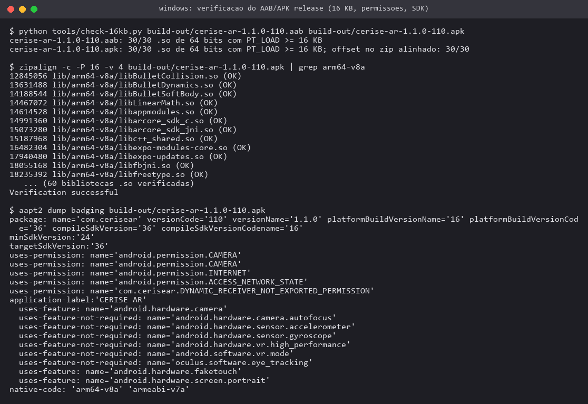

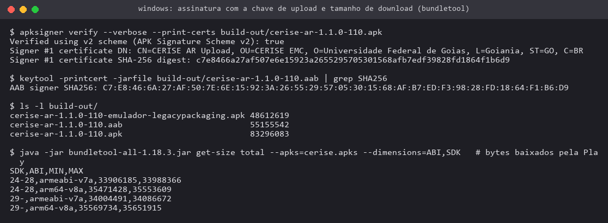

A restrição de ABIs, além de eliminar a falha em x86/x86_64, reduziu o AAB de 75,84 MB para 55,16 MB (−27 %) e o APK universal de 116,82 MB para 83,30 MB (−29 %), conforme a Figura 11 (`resultados/tamanhos-artefatos.json`).

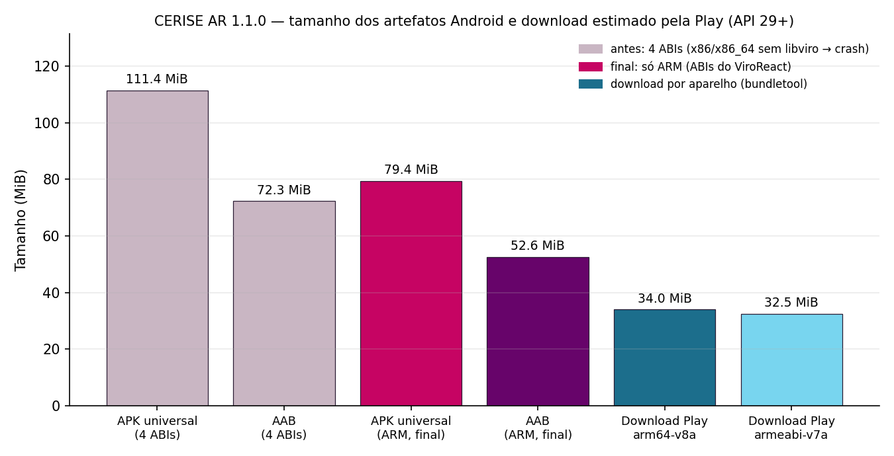

### 4.2 Fluxo de geração 3D no Android (emulador, contra o *mock*)

As Figuras 1 a 4 mostram o app no emulador Android 16. Sem servidor no endereço padrão, a tela de criação e o teste de conexão exibem a falha de forma explícita (HTTP 404 em `/api/v1/health`); após apontar para o *mock*, o teste retorna modelo, GPU, fila e *presets* do servidor (Figura 1). O fluxo completo — foto pelo seletor do sistema, escolha do *preset*, fila com posição e ETA, progresso com estágio e resultado — está na Figura 2; a câmera do sistema (cena virtual do emulador) e o cancelamento na fila (com `DELETE` confirmado no log do *mock*, Figura 12) na Figura 4. Os modelos ficam em *Meus modelos* com miniatura, estatísticas e tempos medidos, e podem ser abertos no visualizador 3D (Figura 3). A lista persistiu após o app ser encerrado e reaberto.

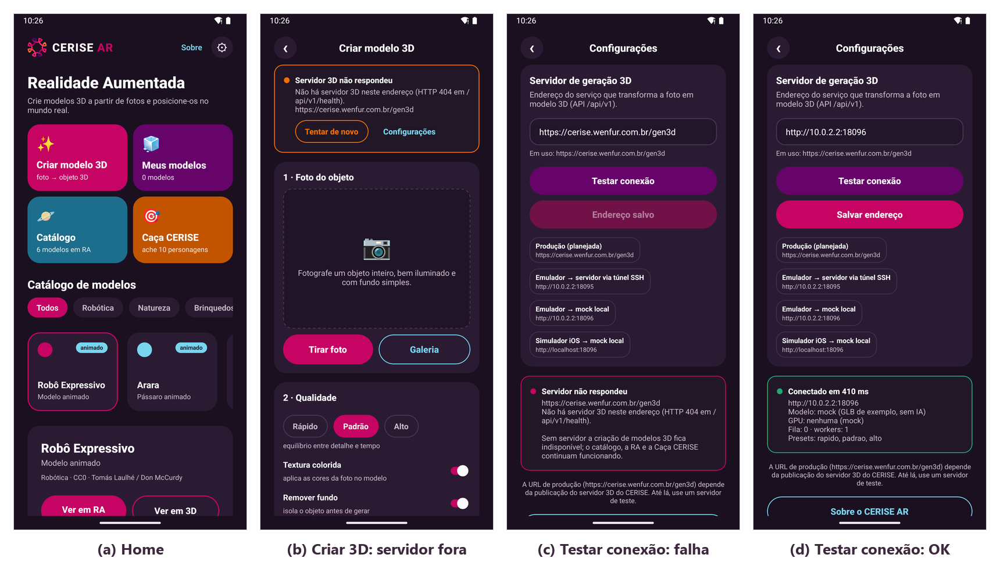

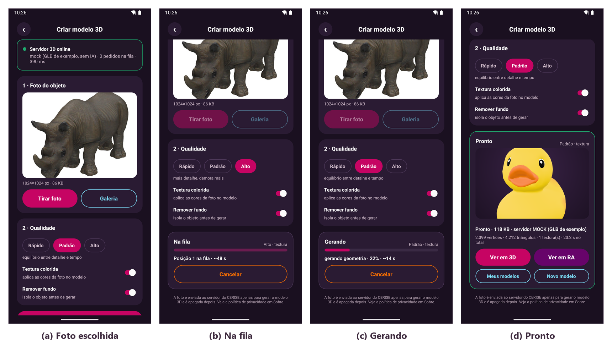

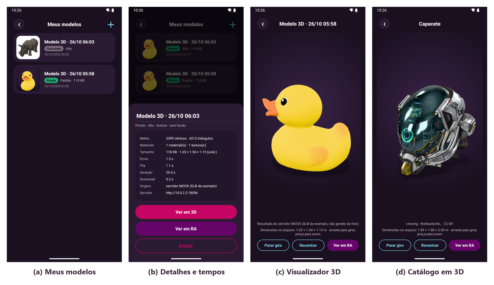

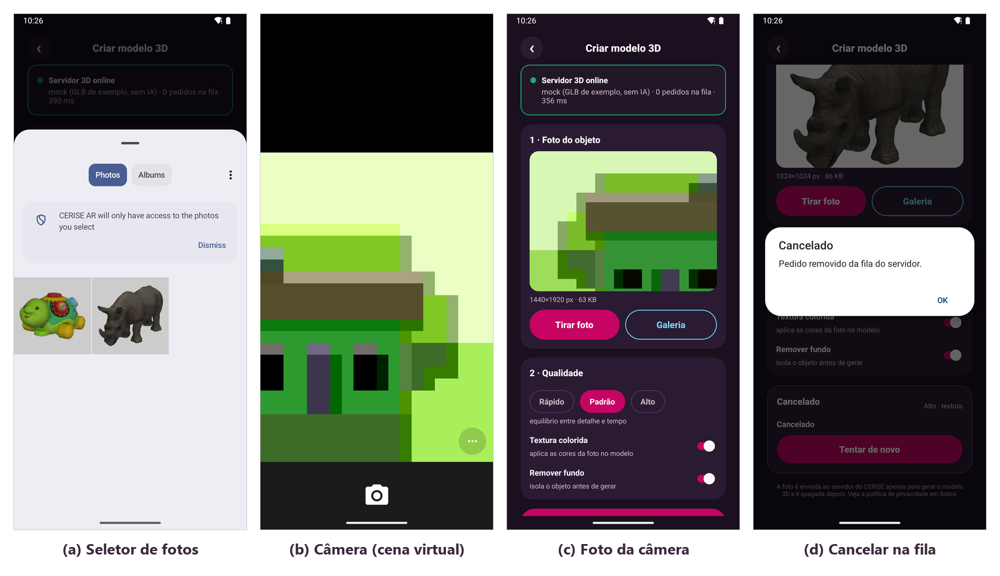

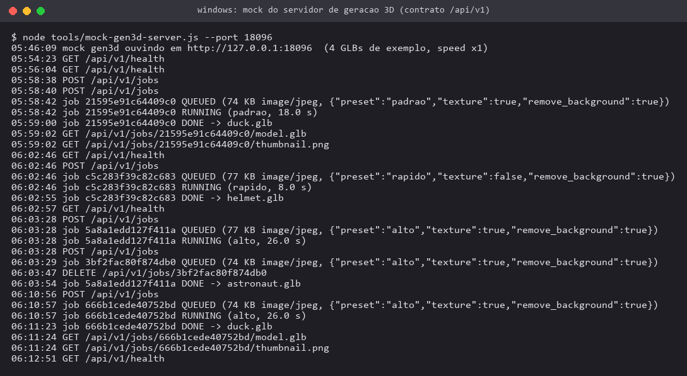

*Tabela 3 — Tempos por etapa medidos pelo app contra o mock (o tempo de geração é simulado pelo mock; os números caracterizam o pipeline do app, não o desempenho do servidor real).*

| Plataforma / pedido | Envio | Fila | Geração | Download | Total | Fonte |
|---|---|---|---|---|---|---|
| Android, Padrão + textura (mock: 18 s) | 3,1 s | 1,1 s | 18,7 s | 0,4 s (118 KB) | 23,2 s | `evidencias/android/A14-detalhes-primeiro-job.png`, `A09-pronto.png` |
| Android, Alto + textura (mock: 26 s), após “Tentar de novo” | 1,3 s | 1,1 s | 26,3 s | 0,2 s (118 KB) | — | `evidencias/android/A20-detalhes-pronto.png` |
| iOS, Rápido + textura (mock: 12 s), atrás de um pedido “Alto” | 0,007 s | 25,1 s | 10,6 s | 0,041 s (3,77 MB) | 35,7 s | `resultados/models-ios.json` |

A fila e a geração são medidas no cliente com a resolução do *polling* (1,5–2 s). O envio no Android inclui a rede NAT do emulador e a tradução ARM→x86 do processo.

### 4.3 iOS (Simulador)

O build Release para o Simulador (sem assinatura) foi concluído em 72 s de `xcodebuild` após `npm ci` e `pod install` (100 *pods*), gerando um `.app` de 41 MB (`br.ufg.cerise.arviewer` 1.1.0, build 2, iOS mínimo 17.6), instalado e executado no *iPhone 17 Pro* (Figura 9). O fluxo de geração, *Meus modelos* e o visualizador 3D funcionaram como no Android (Figura 5).

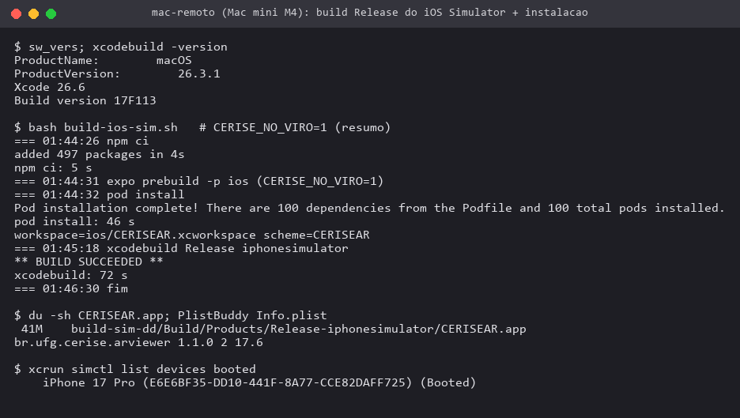

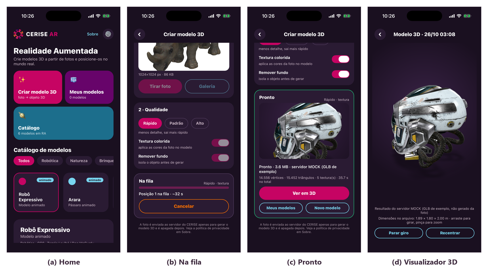

### 4.4 Realidade aumentada no emulador

O *Google Play Services for AR* 1.57 para emulador (oficial, GitHub `google-ar/arcore-android-sdk`) foi instalado no AVD. Como o app contém apenas bibliotecas ARM (exigência do ViroReact) e roda traduzido no emulador x86_64, o cliente ARCore não consegue carregar a implementação x86 (`number_of_symbols_loaded=0`, `AR_ERROR_FATAL`) e o ViroReact encerra o processo (Figura 6b). Portanto **a RA não pôde ser exercitada no emulador**; ela havia sido validada em aparelho físico na versão de setembro/2026 (CERISE Summit). Sem o ARCore instalado, a nova verificação de suporte mantém o app estável e oferece a visualização 3D (Figura 6a).

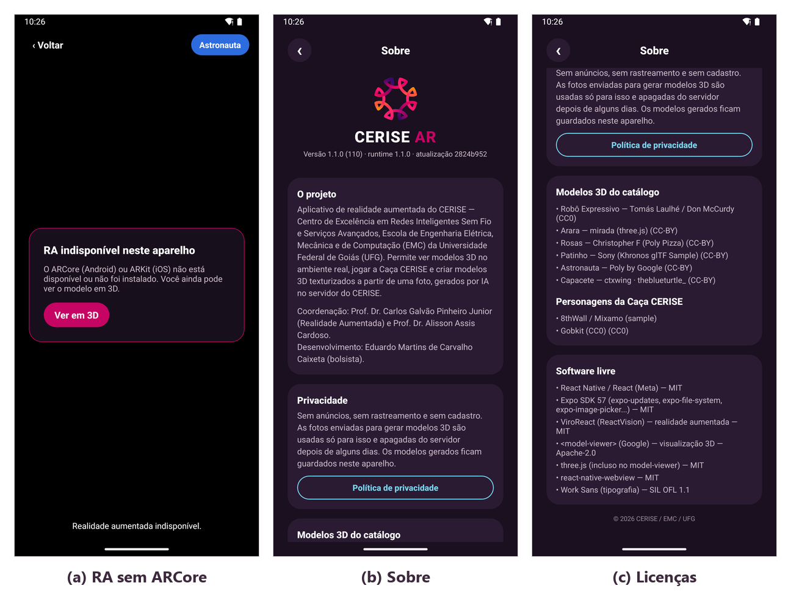

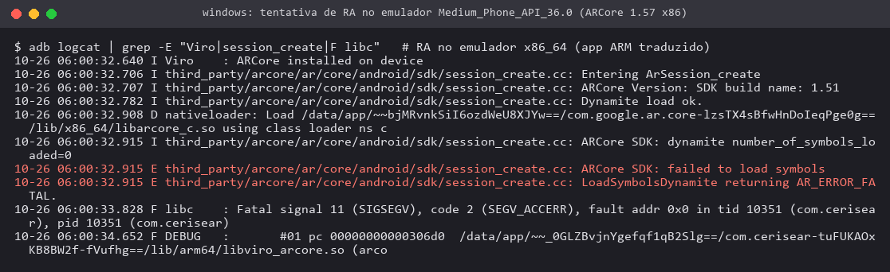

### 4.5 Pacote da loja

As duas capturas da ficha que mostravam o *mock* (criação com o *banner* “mock (GLB de exemplo)” e geração em andamento) foram substituídas por capturas do teste com o servidor real, e foi acrescentada uma sétima captura com um modelo realmente gerado a partir de foto no visualizador 3D (`store/screenshots/phone-2`, `phone-3` e `phone-7`; seleção reproduzível por `store/make-graphics.py`). Nenhuma captura da loja mostra mais o *mock*.

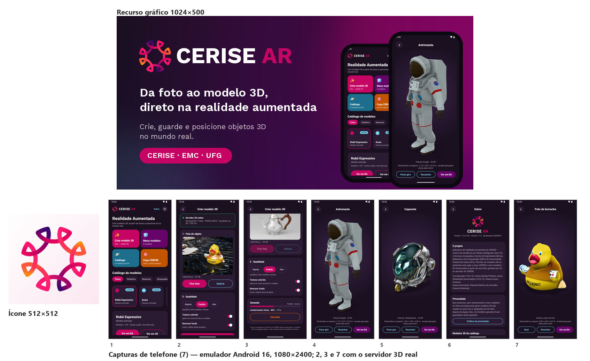

### 4.6 Validação ponta a ponta contra o servidor 3D real (integração final)

**Contrato.** O servidor real seguiu o contrato da Tabela 1 e o app concluiu o fluxo completo já com o build anterior (primeiro teste, burro de cerâmica, preset Rápido: 18,0 s do toque em “Gerar” ao modelo salvo). Não foi preciso alterar o servidor. O teste revelou, porém, quatro pontos que o *mock* não exercitava e que foram tratados no app (só JavaScript, `src/gen3d/` e telas), além de dois ajustes de privacidade e localização:

*Tabela 4 — Ajustes do app feitos a partir do teste com o servidor real.*

| Observado no servidor real | Ajuste no app |
|---|---|
| Download do GLB lento no app: 5,0 s para 398 KB, embora o servidor responda o arquivo em ~1 ms (log da API: 3,1 s entre o início do GLB e o da miniatura) | progresso do download só em degraus de 10 % e **sem gravar** `models.json` a cada evento; miniatura baixada **em paralelo** com o GLB. Mesma foto e *preset* depois da correção: download **0,45 s**, total **13,5 s** (antes 18,0 s) — `resultados/real-antes-depois-download.txt` |
| `/health` devolve `status` `loading`, `paused` ou `degraded` (worker carregando o modelo após reinício, geração pausada, sem worker); o app mostrava “Servidor 3D online” em todos os casos | aviso específico (“Servidor 3D iniciando”, “em pausa”, “sem GPU disponível”) explicando que o pedido vai esperar na fila; estado exibido também em Configurações |
| `POST /jobs` pode responder `202` já com `status: "done"` (resultado do **cache** do servidor) | consulta imediata do job e indicação “do cache do servidor” no resultado e nos detalhes |
| O job informa `timings.queue_s` e `run_s` medidos no servidor | detalhes do modelo mostram “No servidor: fila X s · GPU Y s” ao lado dos tempos medidos no app |
| `DELETE /api/v1/jobs/{id}` de um job concluído apaga a foto e o modelo do servidor | **Excluir** em *Meus modelos* também pede ao servidor que apague a cópia dele (melhor esforço; sem servidor, vale a retenção de 7 dias). Política de privacidade e respostas do Play Console atualizadas |
| Servidor exige `X-API-Key` se for exposto com `GEN3D_API_KEYS` | cabeçalho enviado quando o build/OTA tem `EXPO_PUBLIC_GEN3D_API_KEY`; sem a variável (caso deste AAB), nada é enviado |

Também foram corrigidos a retomada de um download interrompido pelo fechamento do app (o job ficava preso em “Baixando”) e a formatação de números com vírgula decimal nos detalhes e no visualizador.

**Execução.** Com o APK de teste recompilado, foram geradas fotos reais de objetos (imagens CC0 do Wikimedia Commons: pato de borracha fotografado sobre uma mesa de ferro, bule de prata, estatuetas de gato e de burro; copiadas ao emulador com `adb push` e indexadas no *MediaStore*) e escolhidas pelo **seletor de fotos do sistema**, com os três *presets*. Para observar a fila real, um segundo cliente (script `curl` no Windows) enviou um pedido Alto imediatamente antes de um pedido Padrão do app. Por fim, a mesma foto do pato foi reenviada com as mesmas opções para exercitar o cache. As Figuras 13 a 17 mostram cada etapa e a Tabela 5 resume os tempos.

*Tabela 5 — Tempos por etapa medidos pelo app no emulador contra o servidor real (todos com textura e remoção de fundo). “Fila” e “Geração” no app têm a resolução do* polling *(1–2 s); “Execução no servidor” é o `run_s` do job.*

| Objeto · *preset* | Envio | Fila | Geração | Download | **Total** | Fila / execução no servidor | GLB (triângulos) |
|---|---|---|---|---|---|---|---|
| Pato de borracha · Rápido | 0,41 s | 1,25 s | 11,19 s | 0,67 s | **13,5 s** | 0,24 s / 11,20 s | 340 KB (10.000) |
| Burro (estatueta) · Rápido | 0,49 s | 1,35 s | 11,24 s | 0,45 s | **13,5 s** | 0,20 s / 11,26 s | 398 KB (10.000) |
| Bule de prata · Padrão | 0,66 s | 1,36 s | 14,42 s | 0,61 s | **17,1 s** | 0,09 s / 14,73 s | 622 KB (19.998) |
| Gato (estatueta) · Alto | 0,39 s | 1,21 s | 29,04 s | 0,90 s | **31,5 s** | 0,22 s / 30,17 s | 1,44 MB (39.998) |
| Gato · Padrão, atrás de 1 job Alto de outro cliente | 0,40 s | 28,25 s | 15,81 s | 0,46 s | **44,9 s** | 27,85 s / 15,88 s | 662 KB (19.998) |
| Pato · Rápido, reenvio da mesma foto (cache) | 0,29 s | 0,28 s | 0 | 0,43 s | **1,0 s** | 0 / 0 (cache) | 340 KB (10.000) |

Fontes: `resultados/real-tempos-app.csv` (gerado por `resultados/scripts/tempos_e2e.py` a partir de `real-logcat-app.txt`) e `resultados/real-jobs-servidor.json`.

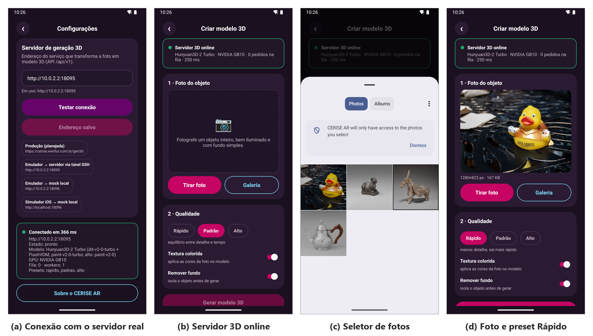

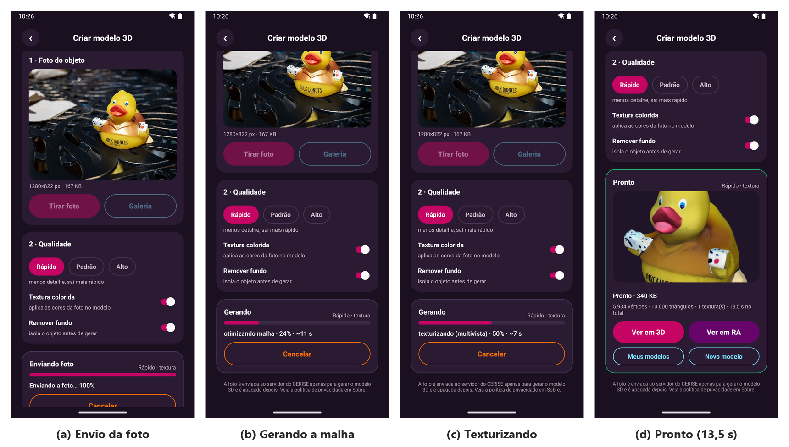

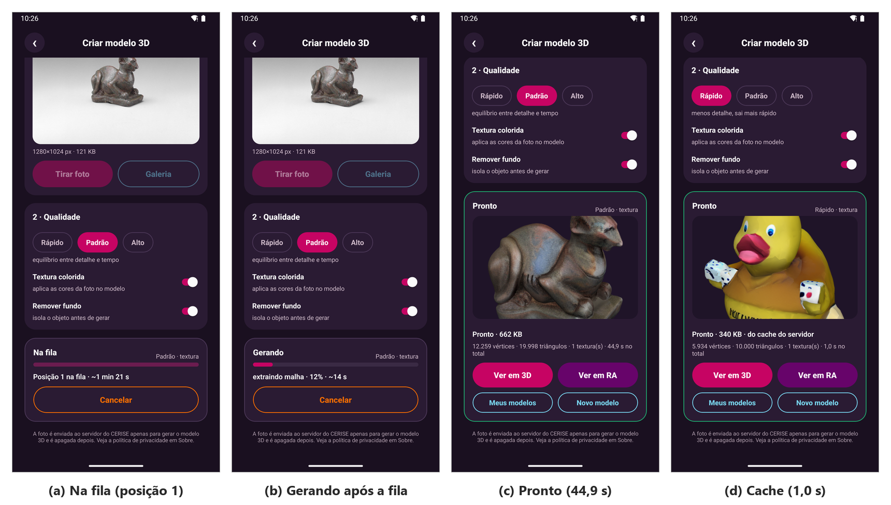

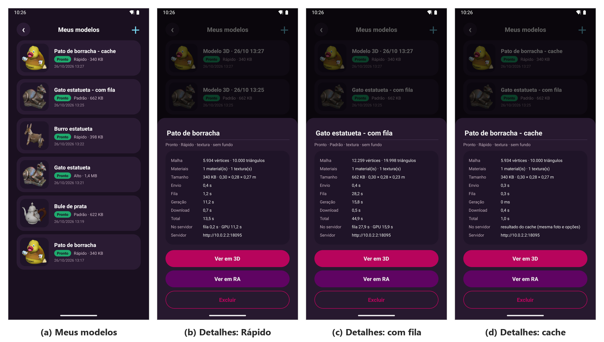

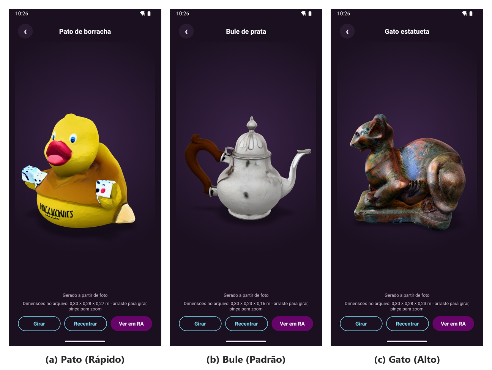

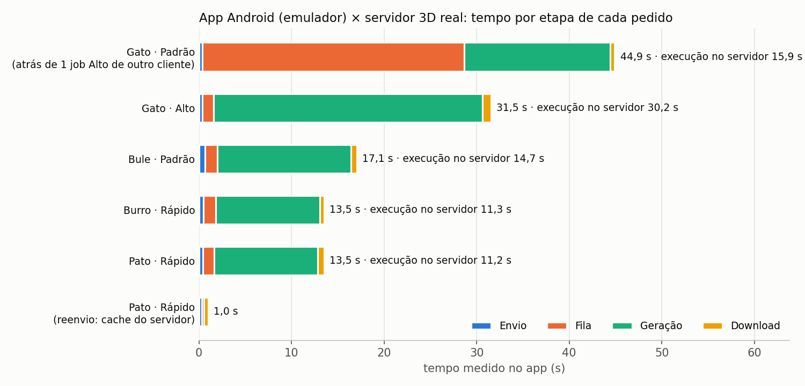

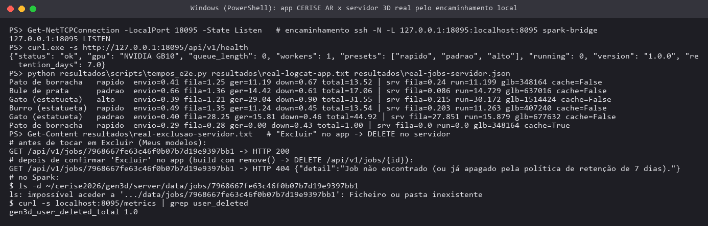

**Análise.** Sem fila, o tempo percebido pelo usuário ficou entre **13,5 s (Rápido)** e **31,5 s (Alto)**, dominado pela execução na GPU (83–96 % do total); envio (0,3–0,7 s para fotos de 109–175 KB) e download (0,4–0,9 s para GLBs de 340 KB a 1,44 MB) somam no máximo 1,3 s, mesmo passando pelo encaminhamento SSH e pela rede NAT do emulador. A “fila” de ~1,2–1,4 s medida no app sem concorrência é artefato do *polling* (primeira consulta 1 s após o envio); o servidor registrou 0,09–0,24 s. Com um job Alto de outro cliente à frente, a espera na fila (28,3 s no app, 27,9 s no servidor) praticamente igualou a execução desse job (28,2 s), como esperado para um único *worker*. O reenvio da mesma foto com as mesmas opções foi atendido pelo cache em 1,0 s sem uso de GPU — o seletor de fotos entregou o arquivo original, de bytes idênticos. Todos os GLB baixados tinham textura JPEG, maior dimensão de 0,30 m e nenhuma extensão Draco/meshopt/KTX2 (`real-jobs-servidor.json`); os três abertos no visualizador embutido (pato, bule e gato Alto) foram exibidos com textura e dimensões corretas (Figura 17). A **exclusão** de um modelo no app removeu o job e a pasta dele no servidor (`GET` passou de 200 para 404; `gen3d_user_deleted_total` = 1 — `resultados/real-exclusao-servidor.txt`).

Um ponto a melhorar no servidor: a **ETA** exibida na fila foi superestimada (“~1 min 21 s” para uma espera real de 28 s), porque a estimativa inicial do *preset* Alto no servidor é de 82 s, enquanto os jobs Alto de hoje levaram 28–30 s; a média móvel do servidor corrige a estimativa com o uso, mas a configuração `GEN3D_EST_SECONDS` pode ser recalibrada.

A **URL pública de produção** (`https://cerise.wenfur.com.br/gen3d`, padrão do app) **depende da decisão de exposição do servidor 3D**, que não foi tomada; até lá o app só gera modelos na rede interna (encaminhamento local), e a versão de produção na Play não deve ser enviada para revisão antes de o servidor responder nessa URL.

## 5. Adequação normativa (resumo)

| Tema | Tratamento |
|---|---|
| LGPD | política de privacidade em PT-BR com controlador, dados tratados (foto opcional, apelido opcional no ranking, dados técnicos), bases legais, retenção (fotos e modelos no servidor por até 7 dias), compartilhamento (nenhum), segurança e direitos do titular |
| Segurança dos dados (Play) | Fotos e Nome declarados como coletados, opcionais, não compartilhados, criptografados em trânsito; sem IDs de publicidade (AD_ID bloqueado) nem SDKs de terceiros |
| Fotos e vídeos (Play, 2025) | sem `READ_MEDIA_*`; seletor de fotos do sistema |
| Propriedade intelectual | remoção de personagens de franquias do catálogo; créditos e licenças na tela Sobre |
| Classificação etária | respostas IARC preparadas (expectativa: Livre); público-alvo 13+ |
| Código dinâmico | atualizações OTA apenas de JavaScript/Hermes (expo-updates), interpretado, sem baixar código nativo |

## 6. Limitações

- **Servidor real validado só pela rede interna:** a integração ponta a ponta (Seção 4.6) foi feita no emulador, pelo encaminhamento SSH local. Não houve teste em aparelho físico nem em rede móvel, e a URL de produção (`https://cerise.wenfur.com.br/gen3d`) não responde enquanto a exposição do servidor não for decidida. As fotos de teste são imagens reais CC0 de objetos (não fotos tiradas com a câmera de um celular); a câmera do sistema foi exercitada só com a cena virtual do emulador (Figura 4).
- **iOS** não foi retestado contra o servidor real: o Mac emprestado não alcança o Spark e não se criam túneis; as mudanças desta integração são só de JavaScript e valem para as duas plataformas, mas o build do Simulador no Mac ainda é o da etapa base (fluxo validado contra o *mock*, Figura 5).
- **Publicações dependentes do Eduardo** (decisão de 26/10/2026: nada é publicado no wenfur): política de privacidade (`https://cerise.wenfur.com.br/privacidade.html` respondia 404), APK de instalação direta (`https://cerise.wenfur.com.br/ota/cerise-ar-1.1.0.apk` respondia 404) — comandos prontos em `store/PUBLICAR_PLAY_STORE.md`, passos 0b e 0c; exposição pública do servidor 3D; passos no Play Console e no App Store Connect, que exigem login.
- **RA** não validada em emulador (Seção 4.4) nem no Simulador iOS (ViroKit sem fatia de simulador); validação em aparelho físico pendente para a 1.1.0.
- O `SoLoader` do React Native não localiza as bibliotecas não comprimidas quando um x86_64 executa o APK ARM por tradução; para o emulador foi gerado um APK de teste com bibliotecas extraídas (`expo.useLegacyPackaging=true`), funcionalmente idêntico. O build da loja mantém o empacotamento padrão.
- O nome de pacote `com.cerisear` pode já estar em uso na Play; nesse caso é preciso trocá-lo e gerar novo AAB (procedimento no guia).

## 7. Próximos passos

1. Decidir a exposição pública do servidor 3D (proposta, riscos e passos no `server/README.md` do repositório `cerise-2026-gen3d`); se for usada chave de API, compilar o app com `EXPO_PUBLIC_GEN3D_API_KEY` (passo 0d do guia). Depois, repetir o teste ponta a ponta em aparelho físico pela rede móvel, com fotos tiradas pela câmera.
2. Publicar a política de privacidade e, se desejado, o APK de instalação direta (comandos prontos em `store/PUBLICAR_PLAY_STORE.md`, passos 0b e 0c), sem alterar o `version.json` do app antigo.
3. Servidor: recalibrar a estimativa inicial do *preset* Alto (`GEN3D_EST_SECONDS`), que superestimou a ETA na fila (Seção 4.6).
4. Play Console: criar o app, enviar o AAB em teste interno, conduzir o teste fechado (12 testadores, 14 dias) e solicitar produção (só depois de o servidor 3D responder na URL pública).
5. iOS: build assinado na sessão gráfica do Mac (com o código desta integração), instalação no iPhone e envio ao TestFlight (`store/IOS_IPHONE_TESTFLIGHT.md`).
6. Validar a RA de modelos gerados em aparelho físico (Android com ARCore e iPhone).

## 8. Artefatos

| Item | Local |
|---|---|
| Código | `cerise-expo/` (branch `feat/2026-gen3d-playstore`; originalmente repo `EduardoCaixeta/cerise-ar`, PR #1) |
| AAB/APK release (fora do git, publicados como *Releases*) | `cerise-ar-1.1.0-110.aab` e `cerise-ar-1.1.0-110.apk` (rebuild final após a integração; SHA-256 em `resultados/final-artefatos-verificacao.txt` e em `RELEASES.md` na raiz); APK de teste do emulador `cerise-ar-1.1.0-110-emulador-legacypackaging.apk` (mesmo bundle JS). Gerados localmente em `cerise-expo/build-out/` |
| Keystore de upload (fora do git por segurança — **fazer backup**) | `cerise-expo/keystore/cerise-upload.jks` + `upload.properties` (somente na máquina do autor) |
| Evidências | `docs/relatorio-2026/evidencias/` (figuras), `evidencias/android/` (22 capturas, *mock*), `evidencias/android-real/` (capturas com o servidor real), `evidencias/ios/` (12 capturas) |
| Métricas | `docs/relatorio-2026/resultados/` (badging, 16 KB, zipalign, assinatura, bundletool, tamanhos, tempos iOS, logs do *mock* e do ARCore); integração com o servidor real: `real-tempos-app.csv/.json`, `real-jobs-servidor.json`, `real-logcat-app.txt`, `real-antes-depois-download.txt`, `real-exclusao-servidor.txt`, `final-artefatos-verificacao.txt`, `final-check-16kb.json`; scripts em `resultados/scripts/` |
| Pacote da loja | `cerise-expo/store/` |
